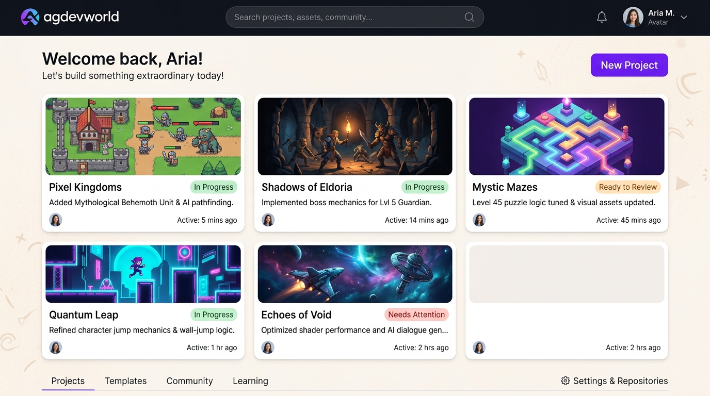
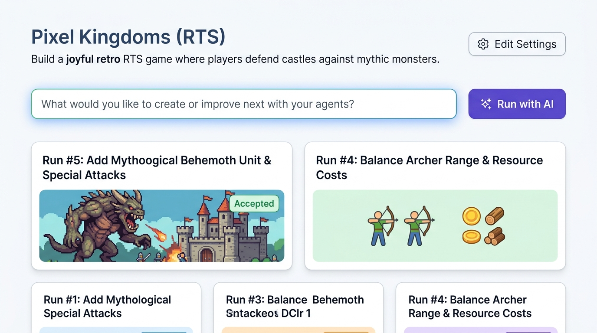
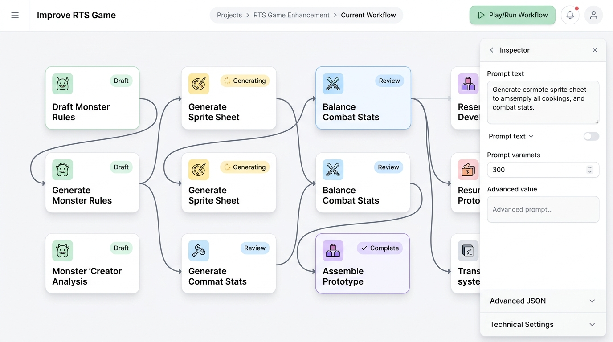
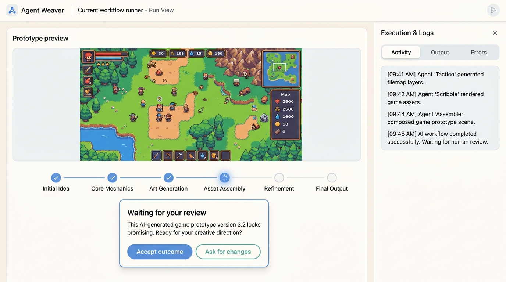

# シンプルで親しみやすいUIへのデザイン提案

本ドキュメントは、`braindump.md` の問題意識、`advice.md` の方針、および `image_before/opinion.md` の画面分析を踏まえ、**「想像力と好奇心を刺激する、リラックスして創作に向き合えるUI体験」** を実現するための具体的な画面コンセプトと提案をまとめたものです。

---

## 1. 背景と課題の整理

### 課題（`braindump.md` より）
- **UIのごちゃごちゃ感**: 画面を開いた瞬間に技術的なメタデータや入力フォーム、長いIDが並び、事務的な管理作業のような印象を与えてしまう。
- **創造的心理状態の阻害**: agdevworldの理念である「想像力を刺激する」体験に対し、情報密度の高さがリラックスした好奇心を削いでいる。
- **安心感とシンプルさの両立**: 基本はエージェントに任せつつ、人間が手動介入したい時には必要な情報・操作が確実に揃っているという安心感を維持する必要がある。

### 基本方針（`advice.md` より）
1. **Outcomes（成果物）と Human Decisions（人間の判断）を日常の主役に**: 何が作られたのか、次に人間は何を判断すれば良いのかを一番目立たせる。
2. **詳細への明確で頼もしい導線（Clear & Dependable Path）**: 実行ログ、生JSON、リポジトリ設定などの技術的情報は常時露出させず、必要な時にいつでも1クリックで引き出せる引き出し（ドロワーやアコーディオン）に整理する。
3. **親しみやすいオブジェクト表現**: 暗号的なID（例: `improve-game/run-005`）ではなく、自然な成果タイトル（例:「神話の巨大モンスターを追加する」）やサムネイルを活用する。

---

## 2. コンセプト画像と各画面の提案

生成したUIコンセプト画像は、本フォルダ内に格納されています。

| 画面 | コンセプト画像 | 主な改善点 |
| :--- | :--- | :--- |
| **Dashboard** |  | フォームを排し、作品のサムネイルギャラリーを中心に |
| **Project View** |  | ビジョン表示、自然言語指示バー、成果タイトル中心のRun履歴 |
| **Workflow Editor** |  | スリムなヘッダー、読みやすい目的志向のノードカード、折りたたみインスペクタ |
| **Run View** |  | 成果物プレビューと人間判断（レビュー）を主役に、ログは右ドロワーへ |

---

### ① Dashboard（ダッシュボード）
**コンセプト画像: `01-friendly-dashboard.jpg`**

#### 現状の課題（Before）
- プロジェクト一覧の右側に新規作成・登録フォームが常時表示されており、技術情報（レジストリ場所、ストレージモードなど）が画面を占有している。
- プロジェクトが「何を生み出しているのか」という成果の視覚的表現が不足している。

#### 提案（After）
- **スタジオ・ギャラリー形式のカードレイアウト**: プロジェクトを成果物（ゲームやプロトタイプ）のサムネイル付きカードとして魅力的に提示。
- **最近のアウトカムと状態の可視化**: 「神話のベヒーモスユニットとAI経路探索を追加」「レビュー待ち」といった人間にとって直感的なステータスを表示。
- **技術的フォームの退避**: 新規作成は「New Project」ボタンからモーダル表示。リポジトリや全体設定は下部タブや控えめなリンクに集約。

---

### ② Project View（プロジェクト概要・ハブ）
**コンセプト画像: `02-friendly-project-view.jpg`**

#### 現状の課題（Before）
- プロジェクトの目的やゴールが「入力フォーム」として表示され、IDやdevdocs設定が同列に並ぶ。
- Run一覧が `improve-game/run-005` のようなIDとステータスチップのみで、どのような変更が行われたのか想起しにくい。

#### 提案（After）
- **プロジェクトビジョンを自然なテキストとして提示**: 「Build a joyful retro RTS game where players defend castles...」のように、創作の目標を読みやすいテキストで掲示（設定編集は「Edit Settings」から明示的に開く）。
- **対話的プロンプト入力バーの配置**: 「What would you like to create or improve next with your agents?」のように、次にエージェントへ依頼したい内容を自然に入力できる親しみやすい指示バーを設ける。
- **成果タイトル中心のRunカード**: IDではなく「Run #5: Add Mythological Behemoth Unit & Special Attacks」のように依頼内容に基づくタイトルと成果物サムネイルを表示。

---

### ③ Workflow Editor（ワークフローエディタ）
**コンセプト画像: `03-friendly-workflow-editor.jpg`**

#### 現状の課題（Before）
- ヘッダーが約290pxと非常に大きく、キャンバスのノードが小さくてテキストが読みにくい。
- ノード未選択時でも右ペインにリポジトリ設定やドキュメントポリシーが表示され、視覚的圧迫感がある。

#### 提案（After）
- **スリムで洗練されたトップバー**: プロジェクトパス、ワークフロー名、実行ボタン（Play/Run）のみを配置し、作業キャンバス領域を大幅に拡大。
- **視認性と遊び心のあるノードカード**:
  - 親しみやすいアイコンとパステルのアクセントカラーを採用。
  - 「Draft Monster Rules」「Generate Sprite Sheet」「Assemble Prototype」など、目的がひと目で伝わる太字タイトル。
- **コンテキスト連動型インスペクタ**:
  - ノード選択時のみスライド表示される設計。
  - プロンプト文やパラメータ調整など「人間が触りたい箇所」を上部に配置し、「Advanced JSON」や「Technical Settings」はアコーディオンで折りたたんでおくことで、安心感を損なわずにすっきりさせる。

---

### ④ Run View（実行・レビュー画面 - 最重要）
**コンセプト画像: `04-friendly-run-view.jpg`**

#### 現状の課題（Before）
- 実行画面の上部にメタデータ、タイムスタンプ、全ノード状態の凡例が密集。
- 肝心の成果物（Presentations）が下部に追いやられ、初期画面で見えなくなっている。
- 過去の完了した質問が縦に長く居座り、現在のフォーカスがぼやける。

#### 提案（After）
- **成果物（Outcome Preview）ファースト**:
  - 画面のメインエリア上部に、作成されたゲームやプロトタイプのプレビュー画面を大きく表示。
- **人間の判断（Decision）をセンターに**:
  - プレビューの直下に「Waiting for your review」カードを配置。「Accept outcome（承認）」「Ask for changes（修正依頼）」ボタンを分かりやすく提示し、人間が次に何をすべきかを迷わせない。
- **穏やかなパイプライン進捗バー**:
  - ノードの複雑な技術グラフではなく、「Initial Idea → Core Mechanics → Art Generation → Asset Assembly...」といった進行状況を示すステップバーをコンパクトに配置。
- **折りたたみ可能なログドロワー（Execution & Logs）**:
  - エージェントのログや技術的な実行結果は右側のドロワーにまとめ、必要な時だけ開いて確認・調査できるようにする。

---

## 3. 実装に向けた推奨アプローチ

1. **まずは Run View のレイアウト再構成から着手する**:
   - 全面的なグラフィック刷新を一度に行うのではなく、既存コンポーネントの配置順序（成果物プレビューを上へ、ログや技術情報を折りたたみペインへ）を変更するだけでも劇的な改善が得られます。
2. **既存の堅牢な基盤・状態保護を維持する**:
   - 既存実装の優れた点である「ノード状態とExecutor活動の峻別」「バックグラウンド更新時に入力中の下書きやフォーカスを失わない仕組み」はそのまま活かします。
3. **自然言語タイトルの活用**:
   - Run表示において、機械的なID（`improve-game/run-005`）の前に、ユーザーのプロンプト/リクエストから生成された要約タイトル（「神話モンスターの追加」など）を表示するだけで、親しみやすさが大幅に向上します。
