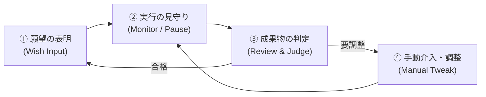
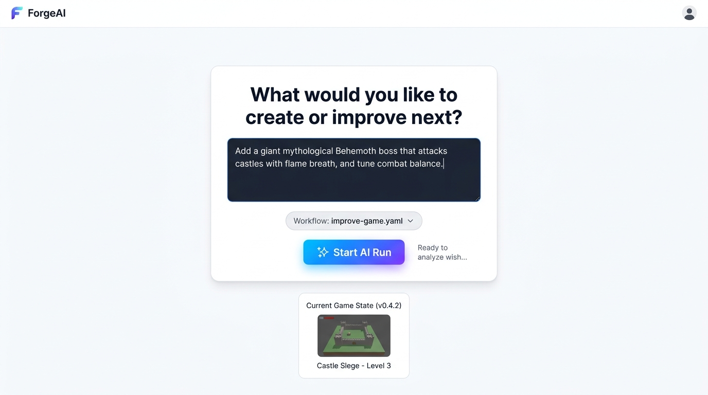
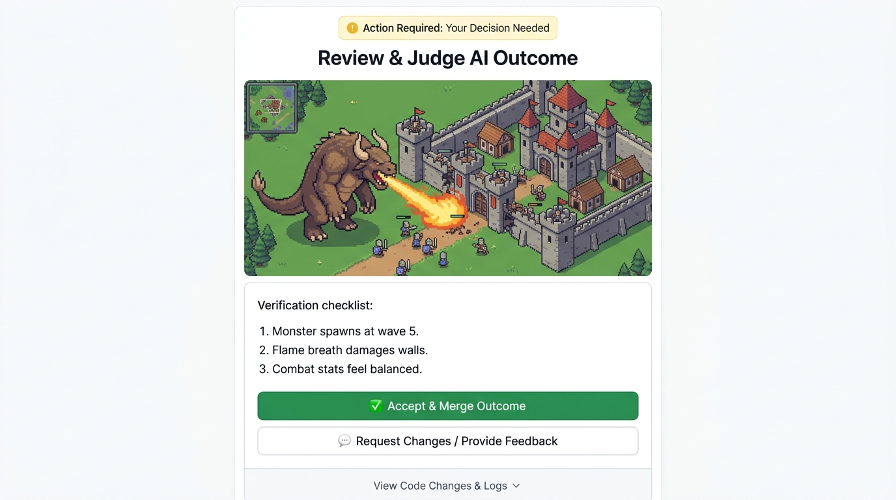
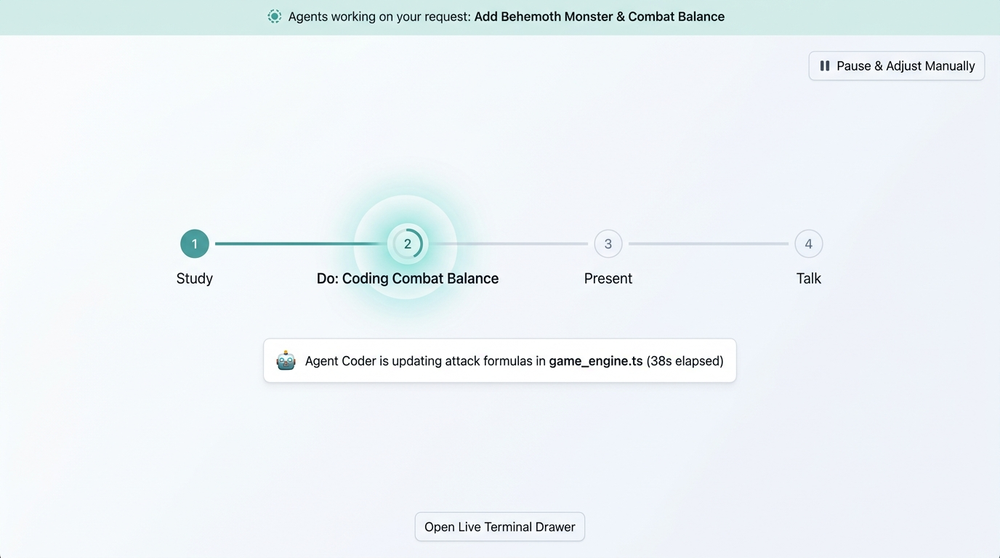
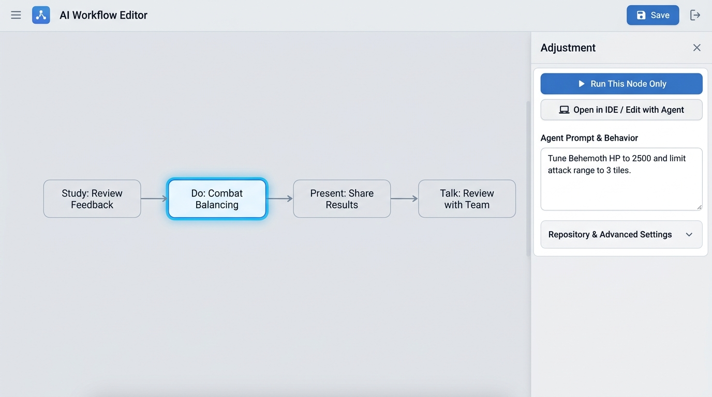

# エディタ操作の原点回帰と「次の一手」が明白なUI設計（Take 2 提案）

前回のTake 1では「画面全体の情報の整理と見た目のシンプルさ」を中心に取り上げましたが、本Take 2ではユーザーからのご指摘に基づき、**「ユーザーが今何をすればいいのか」「UIがユーザーに何をさせたいのか（Primary Action）」** を最も分かりやすくすることに主眼を置いて再設計を行いました。

---

## 1. このエディタで行う本質的な操作の見直し

`p7/braindump.md`、`discussion/workflow_editor`、および `advice.md` の記録から、このエディタにおける人間の本質的なサイクルは以下の**4つの状態（Phase）**に集約されます。

日常のほとんどの場面で、ユーザーがエディタを開いた理由は以下のいずれかです：
1. **「次のアイデア・願望をエージェントに頼みたい」**
2. **「エージェントが作った成果物をチェックして合否を決めたい」**
3. **「エージェントの作業を手動で少し修正したい／単体テストしたい」**

UIがこれらの目的と同期し、**「開いた瞬間に次に行うべき操作（ボタンや入力欄）が迷いなく目に入る」** ように設計しました。

---

## 2. 4つの操作状態とコンセプト画像

| 操作状態 (Phase) | コンセプト画像 | ユーザーが「今すべきこと」 / UIが「させたいこと」 |
| :--- | :--- | :--- |
| **① 願望の表明 (Launch)** |  | **やりたいことを入力して「Start AI Run」を押す** |
| **② 成果物の判定 (Review)** |  | **ゲームを触って確認し、「合格」か「修正依頼」を押す** |
| **③ 実行の見守り (Monitor)** |  | **進捗を眺めつつ、必要なら「Pause」で止める** |
| **④ 手動介入 (Tune)** |  | **ノードの指示を微調整し、「単体再実行」または「IDE」を押す** |

---

### Phase 1: 願望の入力（Express Wish & Launch）
**コンセプト画像: `01-action-wish-input.jpg`**

> **ユーザーが今すべきこと**: 次に作りたいもの・改善したいアイデアを書いてエージェントを走らせる。

#### UIが誘導する操作
- **中央の入力カード**:
  - `What would you like to create or improve next?` という大きな問いかけ。
  - 自然言語でやりたい願望を入力（例:「神話のベヒーモスを追加して城への攻撃と戦闘バランスをテストして」）。
- **明確なプライマリアクション**:
  - 迷う余地のない大きな **`✨ Start AI Run`** ボタン。
- **安心のためのコンテキスト**:
  - どのワークフローを使うか（`Workflow: improve-game.yaml`）の選択ピル。
  - 下部に直前の確定バージョン（`Current Game State (v0.4.2)`）を小さく配置し、何に対する追加・改善なのかを想起させる。
- **無駄なノイズの排除**:
  - この段階でGitのブランチや詳細な内部ログ、複雑なDAGグラフを常時表示せず、まず「願望の送信」に集中させます。

---

### Phase 2: 成果物の受取と判定（Review & Judge AI Outcome）★最重要
**コンセプト画像: `02-action-review-judge.jpg`**

> **ユーザーが今すべきこと**: 立ち上がった成果物（ゲームやプロトタイプ）をテストプレイし、合格（Accept）か差し戻し（Feedback）かを下す。

#### UIが誘導する操作（「人間のターン」の完全な可視化）
- **注意喚起バナー**:
  - 上部に `⚠️ Action Required: Your Decision Needed`（あなたの判断が必要です）を明示し、エージェントではなく人間の番であることを伝達。
- **ワンクリックで遊べるプレビュー（Presentation）**:
  - ファイルを探して開く手間（p7での課題）をなくし、画面中央にゲーム画面をそのまま表示。その場でキーやマウスで操作・確認できる。
- **検証チェックリスト（Verification Checklist）**:
  - エージェントが今回実装したポイント（1. 第5波でモンスター出現、2. 城壁への火炎ブレス、3. 戦闘バランス）を提示し、人間が「何を見ればいいか」を迷わせない。
- **二者択一の明確な意思決定ボタン**:
  - **`✅ Accept & Merge Outcome`（合格して反映）**: 緑の強調ボタン。満足ならこれを押すだけで次のサイクルへ。
  - **`💬 Request Changes / Provide Feedback`（修正依頼）**: 違和感があればフィードバックを入力して再試行。
- **詳細情報の控えめな配置**:
  - 差分コードや詳細ログを見たい人向けに、最下部に `View Code Changes & Logs ∨` のトグルリンクを用意（普段は隠して判断に集中）。

---

### Phase 3: エージェント実行中の見守り（Serene Monitoring）
**コンセプト画像: `03-action-running-progress.jpg`**

> **ユーザーが今すべきこと**: リラックスして待つ（または必要に応じて一時停止する）。

#### UIが誘導する操作
- **いま何をしているかの透明性**:
  - 上部に `Agents working on your request: Add Behemoth Monster & Combat Balance` と依頼内容を表示。
  - 4ステップ（Study → Do → Present → Talk）のうち、現在ステップ2（Do: Coding Combat Balance）が実行中であることが柔らかなアニメーションで一目瞭然。
  - `🤖 Agent Coder is updating attack formulas in game_engine.ts (38s elapsed)` という人間が読んで安心できる現在のアクティビティ文。
- **いつでも介入できる安心ボタン**:
  - 右上に **`⏸ Pause & Adjust Manually`（一時停止して手動調整）** を常に配置。「変な方向に進みそうなら止められる」というコントロール感を保証。
- **ログの隔離**:
  - ターミナルの生ログは最下部の `Open Live Terminal Drawer` に収め、画面が流れるログでごちゃつくのを防ぐ。

---

### Phase 4: 手動調整と単体再実行（Manual Adjustment & Single-Node Run）
**コンセプト画像: `04-action-manual-tune.jpg`**

> **ユーザーが今すべきこと**: エージェント任せでは上手くいかない箇所を、ピンポイントで修正・テストする。

#### UIが誘導する操作
- **触りたいノードを選択**:
  - ワークフローのDAGキャンバス上で、問題のノード（例: `Do: Combat Balancing`）をクリック。選択ノードが青いフォーカスリングで強調。
- **右パネル（Adjustment）が提示する3大アクション**:
  1. **`▶ Run This Node Only`（このノードだけ再実行）**:
     - 全体を通しで実行するのではなく、このステップだけ即座に試したいという実務ニーズにダイレクトに応える。
  2. **`💻 Open in IDE / Edit with Agent`（IDEで開く）**:
     - 複雑なコード修正はWeb UIで無理にやらせず、普段使いのVS Code等へスムーズに引き渡す。
  3. **`Agent Prompt & Behavior`（プロンプト・指示の調整）**:
     - 「HPを2500にして射程を3マスに制限して」といったエージェントへの指示文を直感的に書き換えられる。
- **高度な設定の隠蔽**:
  - リポジトリ紐付けやメモリ、タイムアウト等は下部の `Repository & Advanced Settings ∨` にアコーディオンで収納。

---

## 3. 「次の一手」を迷わせないためのUI実装原則

1. **「いま誰のターンか」をヘッダーで一貫して明示する**:
   - `Ready for Next Wish`（あなたのターン：願望入力）
   - `Agents Working...`（エージェントのターン：待機・一時停止可能）
   - `Action Required: Review Outcome`（あなたのターン：合否判定）
2. **1画面における最大Call-To-Action（主ボタン）は1〜2個に厳選する**:
   - 画面内に同じ重みのボタンが大量に散らばっている状態を廃止し、最優先の操作（例: `Start Run`、`Accept`、`Run Node Only`）だけをアクセントカラーで強調する。
3. **成果物と判定チェックリストを同じ視界に入れる**:
   - 成果物を見ながらスクロールせずに判断ボタンを押せる配置にすることで、思考の分断を防ぎ、リラックスしたテンポで開発ループを回せるようにする。
