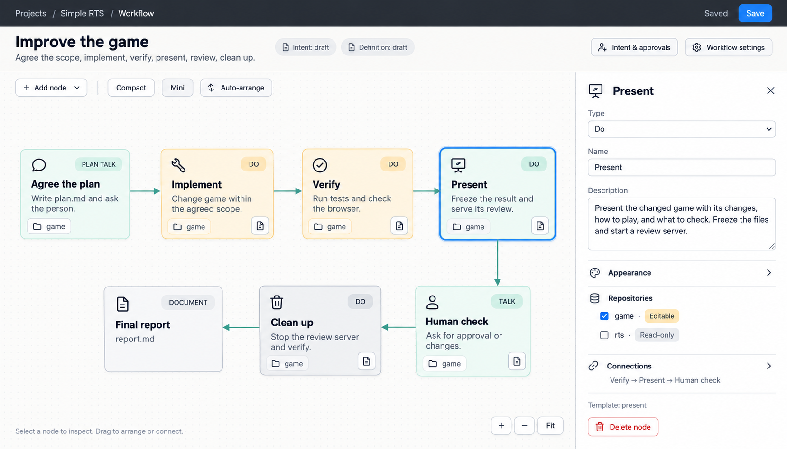
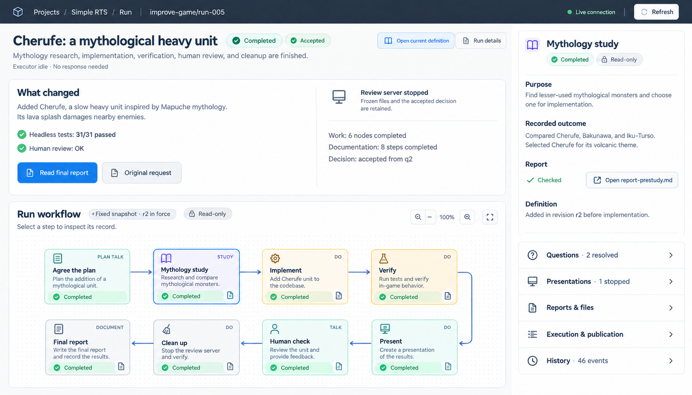

# Take 3：実際の操作モデルに沿ったコンセプト

OpenAIの組み込み画像生成ツールと `imagegen` スキルを使用。実画面のスクリーンショットを機能の参照として渡し、定義編集と完了したRunの確認という2つの画面を生成した。画像内の表記は可読性を優先して英語にしている。

## 1. ワークフロー定義の編集

- 実際の `improve-game.yaml` にある Implement → Verify → Present → Human check → Clean up を維持。既定のドキュメントポリシーが加える計画合意と最終報告も表示。
- PresentとClean upはDoノード。アイコンと色で役割を区別する。各ノードの小さな文書アイコンは報告ステップの入口。
- ノードを読みやすい大きさにし、2段に配置。右側には実際の編集項目である種類、名前、説明、外観、リポジトリ権限、接続を置く。
- 意図と定義の承認状態を常時確認でき、詳細な意図・承認操作、ドキュメントポリシー、リポジトリのバインディングには明示的な入口を残す。
- 保存対象は再利用するワークフロー定義。Run中の進捗や完了状態はこの画面には載せない。

## 2. 完了したRunの成果と記録の確認

- 実際の `improve-game/run-005` に基づく。「チェルフェ追加」という成果、検証結果、人間の確認結果を上部に配置。
- Run固有の定義変更r2で追加されたMythology studyを含むグラフを表示。現在の再利用定義を開く操作と、このRunの記録を見る操作を区別する。
- 作業ノード6件とドキュメントステップ8件の完了を別々に表示。実行ホストがidleであることもノードの完了とは別に示す。
- プレゼンテーションは実際に停止済み。ライブのゲームプレビューを描かず、保存されたファイルと承認記録が残ること、最終報告を読めることを示す。
- 選択ノードの説明と結果は読み取り表示。解決済みの質問、プレゼン、ファイル、実行・公開記録、履歴には折りたたんだ入口を設ける。

## 前の案から見直した点

今回の画像には、現状で提供していない「ノードだけ再実行」「Pause」「ライブターミナル」「汎用モデルパラメータ」を入れていない。実際にないスプライト生成工程や複雑な分岐も加えていない。

見た目の変更は、読みやすいカード、細いヘッダー、控えめな色、情報の配置と折りたたみに集中している。新しい実行機構を作ることを前提としない提案である。

## 実装時に詰めること

これらは実装済みUIのスクリーンショットではなく、配置と表現のコンセプト画像。

- 成果の見出し・要約は表示上の提案。生成要約を追加するか、既存の依頼文や報告から表示するかは別途決める。画像の要約は既存記録に基づき手動で指定した。
- 「Read final report」「Original request」は既存ファイルを開く入口の配置案。折りたたみやインスペクタの開閉も表示変更案である。
- 画像では最終報告を通常のカードに近い大きさで描いているが、新しいユーザー定義ノードの種類を追加する意味ではない。ドキュメントステップとしての区別を実装で保つ。
- 報告アイコンを含む全ノードの数、状態、依存関係は既存のコンパイラとRun記録から描画する。画像内のカードや文章をそのまま実装仕様としない。
- 2段の配置は今回の小さな直列グラフの例。並列分岐や大きなグラフでは、実際の依存関係に従った配置とズームを使う。
- 「意図と承認」を開いたときは、正本の意図、宣言された承認者、意図と定義それぞれの承認操作を保持する。
- 入力中の下書き、フォーカス、IME、読んでいる位置を守る現在の仕組みを再配置後も保つ。
- 未回答の質問があるRunや、稼働中のプレゼンをレビューする画面は今回の2枚の対象外。追加検討では現状の質問への回答とレビューリンクの仕組みに沿って描く。

最終的な生成プロンプトとRun画像の修正プロンプトは [prompts.md](prompts.md) に保存した。参照した実画面は [定義編集](../../image_before/03b-workflow-node-selected.png) と [完了Run](../../image_before/04c-run-viewport.png)。
