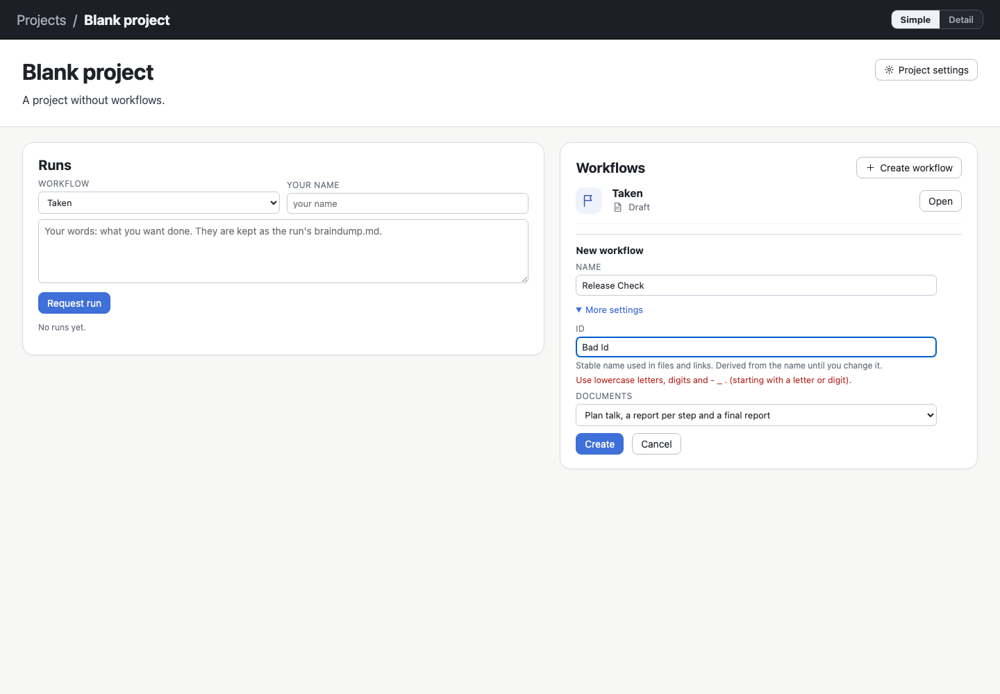

# p8/ex2 step 1 — Create workflow from Simple

Step 1 of [plan.md](plan.md). It is implemented and committed in agdevworld `baaa088`. Nothing is deployed:
the installed release is still `6bdcd3b`.

## What changed

- **One entry in both modes.** The workflow card of the project view has **Create workflow** in its head. The
  old form was Detail-only and said "Create one in Detail." in Simple; that form is gone. An empty list says
  "No workflow yet." and offers **Create the first one**, which opens the same form.
- **Minimal input.** The form asks for a **Name**. Everything else is behind **More settings**:
  - **Id.** It is derived from the name (`Release Check` → `release-check`, combining marks dropped). A name
    without Latin words gives `workflow-2`, `workflow-3`, … The derived id is never one the project already
    uses, and it follows the name until the person types their own.
  - **Documents.** These are the documentation policies, in words. Step 3 adds the per-item settings.
  - **Start from.** This is the template, a general entry point (`server/templates.ts`, `GET …/workflow-templates`,
    `wfe workflow templates`, `wfe workflow new --template`). It only shows when there are at least two
    templates. Today there is only `empty`, so it stays hidden until step 5 adds `freework`.
- **Errors where they belong.**
  - The service's refusals now carry the field they concern (`detail.field`: `id`, `policy`, `template`).
  - The form shows each refusal beside its field, with `aria-invalid` and `role=alert`.
  - A refused id or policy opens More settings. Typing clears the message.
  - Everything typed is kept.
- **Input is not lost.**
  - The form is built once and moved, never rebuilt, when the project view renders again.
  - A render keeps the keyboard and the caret where they were (`keepingFocus`).
  - The Simple/Detail switch shows the same form (one DOM).
- After **Create**, the new workflow opens in the editor, in the mode the person was in.

## Verification

| Check | Result |
| --- | --- |
| `npm run check` | tsc clean; **219/219** tests (`test/createform.test.ts`: deriving the id from the name and its uniqueness; `test/workspace.test.ts`: refusals by field and creation from a template) |
| `checks/freework.ts` (new, port 8216) — creation section | 19/19: the entry in Simple on an empty project and on a project with workflows; the keyboard in Name on opening; More settings closed; an empty name refused beside Name; the id following the name; the same form and text after Simple → Detail → Simple; **a background reload while typing** (a workflow file appears on disk) keeps the text, the keyboard and the open form, and moves the derived id past the id that appeared; a taken id and a malformed id refused beside Id with More settings opened; Create opens the editor in Simple with the given name; no console errors |
| `checks/displayMode.ts`, `checks/simplerUi.ts` | all passed (the project view's other drafts and Simple's other screens are unchanged) |

Screens: [create-open-simple.png](images/create-open-simple.png),
[create-error-simple.png](images/create-error-simple.png) (1440 × 1000, Chromium).

## Notes

- The check ran in Chromium, not Safari, and synthetic input is not a native macOS IME. The same caveat as p8
  and p8/ex1 applies.
- README: a "Creating a workflow (p8/ex2)" paragraph and the new check.
