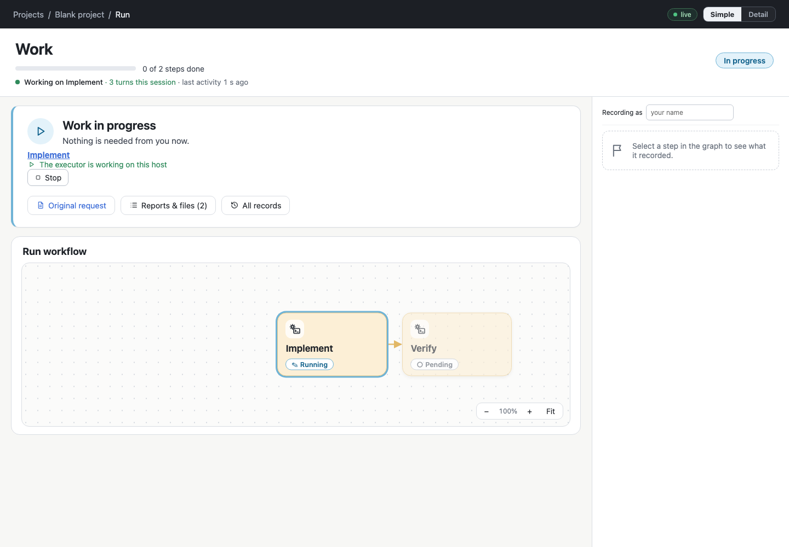

# p8/ex2 step 2 — the activity line

Step 2 of [plan.md](plan.md). It is implemented and committed in agdevworld `e26cd23`. It is not deployed: the
installed release is still `6bdcd3b`.

## What the person sees

Under Simple's progress bar, one line says that the run is moving, without the log:

> ● **Working on Implement** · 3 turns this session · last activity 1 s ago

- **The current work:** the running node's name, or "Between steps" while a session is open with nothing
  recorded as running.
- **Turns this session:** the agent's responses in its current attempt, counted from its own output on this
  host. A new session (after an answer or a resume) starts again from zero. The tooltip says so.
- **Last activity:** the age of the session's last output. It ticks every second.
  - It does not announce anything: no live region, no per-second reading.
  - A new turn makes the line pulse once. There is no motion under `prefers-reduced-motion`.
- **Every other state replaces the count with what it is:**
  - Queued (starts when the executor is free).
  - Starting a session.
  - Waiting for *person*.
  - Held (nothing runs until it is resumed).
  - Stopping.
  - *Work* · the session's process is not running.
  - *Work* · the session runs on another host; its activity is observed there.
  - Not connected · activity is not observed until the view reconnects.
  - Finished. Cancelled. Not started.
  - A history view (`/at/<commit>`) has no line at all.
- **Detail** lists each attempt's turns and last output time in Execution and publication.
- **A run whose plan has grown** (adjustments) shows "3 steps done · the plan of this run has grown once"
  instead of "3 of 7" and a bar. A fraction of a graph that can still grow would read as time left.

## How it is counted (the decisions of report 0)

- `server/activity.ts` reads the attempt's log, `<area>/.local/exec/logs/<attempt>.jsonl`:
  - **Unit:** a turn is one distinct assistant `message.id` of a Claude Code stream-json log. One response is
    several `assistant` events with the same id; they count once.
  - **Other formats:** a log whose first line is not a stream-json event is not counted (`unit: null`). The view
    then says only when the output was last written.
  - **Last activity:** the log file's modification time. Only the agent process writes that file, so executor
    heartbeats, SSE reconnections and the view's 3 s polling never count as activity.
  - **Incremental:** each log keeps a cursor (byte offset up to the last complete line, the ids seen, the inode).
    A re-read costs only what was appended and gives the same count. A partial line waits for its end. A
    replaced or truncated file is read from the start. Concurrent reads of one log share one advance.
- `GET runs/<wf>/<run>/exec` (and `wfe exec status <run>`) gives every attempt an `activity` summary:
  `{unit, count, last, bytes}`. It is `null` for an attempt on another host. No log text leaves the service.
- The view's states come from one pure function (`src/runActivity.ts` `describeActivity`). It keeps the record
  (current work, waits, holds), this host's observation (process, turns, last output) and the connection apart.

## Verification

| Check | Result |
| --- | --- |
| `npm run check` | tsc clean; **227/227** tests. New: `test/activity.test.ts` (4: duplicated events, re-reads, appended output, a partial line, concurrent reads, another format, no log, a replaced and a truncated log) and `test/activityline.test.ts` (4: every state, nothing unobserved stated as a number, the age format) |
| `checks/freework.ts` activity section | 15/15, on a **real claimed attempt** (ExecStore `request` → `claim` → `started` with a live process) whose log the check writes while the view is open: queued; between steps, 0 turns; *Working on Implement · 3 turns* with the working tone; the age updates by itself while the count stays; **a reload shows the same count**; new output raises it and the line pulses; no live region; Detail's attempt list shows the turns; **the process killed** → no count, "process is not running"; **the service stopped** → "Not connected", then current again after it restarts; a question asked and the session ended → "Waiting for Sample Person"; a history view has no line |
| `checks/simplerUi.ts`, `checks/displayMode.ts`, `checks/runInteraction.ts` | all passed |

The whole `checks/freework.ts` (creation and activity) passes. Its presentation fixture now uses its own port
range (18840–18849) and is stopped at the end.

## Problems met and fixed

- **The patcher moved the line's children into another paragraph.** The title band is patched in place
  (`patchContent`), and an unkeyed persistent `
` was matched against the previous render's paragraph. The
  line now carries a `data-key`, so it is always matched by identity.
- **Lingering presentation servers.** My first check runs left nine fixture presentation servers listening on
  18820–18829 (temporary config, not production), and `checks/displayMode.ts` could not find a free port. I
  stopped them, and the check now calls the fixture's `stop()` and uses its own range. Afterwards nothing listens
  on 18840–18849.

## Limits

- Only Claude Code stream-json logs are counted. Every attempt on this host so far has been `claude_code`. A
  log from another harness gets the time without a number, as planned.
- The count is the session's, not the node's: a log carries no node boundary, and inventing one would be a
  guess.
- Chromium only; Safari not checked for this line.
