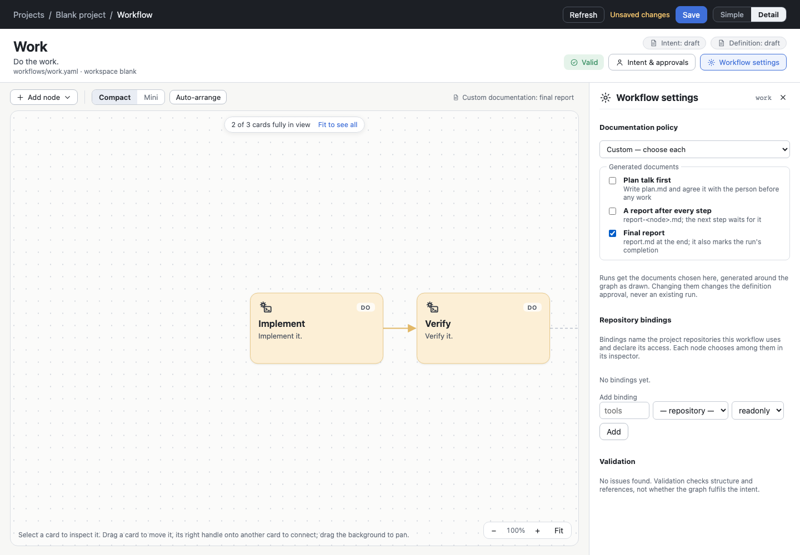

# p8/ex2 step 3 — documentation settings chosen one by one

Step 3 of [plan.md](plan.md). It is implemented and committed in agdevworld `0f61bae`. Nothing is deployed:
the installed release is still `6bdcd3b`.

## The format (as decided in report 0)

```yaml
documentation:
  policy: custom     # default | manual | custom
  plan: false
  reports: false
  final: true
```

- `default` (all three) and `manual` (none) keep their meaning, their YAML and their approval digests.
- `custom` declares all three as YAML booleans:
  - a missing one is the error `documentation-steps`;
  - `default` / `manual` with any of the three is the same error (a contradiction);
  - a non-boolean (`"true"`, `yes-please`, `1`, a list) is a shape problem and leaves the file read-only.
  - Nothing is reconciled on reading.
- `docSteps()` (`shared/model.ts`) normalizes a declaration to `{plan, reports, final}`, and `docStepsOf()`
  (`shared/compile.ts`) does the same for a frozen graph. Compiler, validation, the run reducer, notifications,
  the execution brief, the bundle check, the CLI and every view now read these steps. Every `policy === 'default'`
  branch is gone.
- The definition digest projects the three keys only under `custom`. Any change of one of them makes the
  definition approval stale.

## The compiler, `ag.wfe-compile.v3`

- **Plan** (`plan`): `_plan` goes before the entry nodes.
- **Reports** (`reports`): `A → _report.A → B`. Without reports, `A → B` stays as it is.
- **Final report** (`final`): `_final-report` follows each terminal node, or that node's report.
- **The final report's text without node reports.** Its instructions no longer claim "its reports are
  complete". They cite the nodes' recorded outcomes, artifacts, questions and answers instead.
- **Graphs record their setting** (`documentation`). A v2 graph is read by its policy.
- **No change for existing policies.** For `default` and `manual`, v3 produces exactly the v2 nodes, edges
  and instructions. A test pins this, and `custom` with all three on (or all off) equals `default` (or `manual`).

## Running and adjusting

- A custom run freezes its steps.
- The brief names exactly the steps the run has, and says which documents it has none of.
  - Example: "Documentation policy: custom (final report). _final-report is a step of this run … This run has no
    plan talk and no per-node reports: …"
- An adjustment compares the policy's name **and** its normalized steps:
  - changing one step is `adjust-access`, and so is `custom` → `default`;
  - a v2 and a v3 graph of the same policy compare equal.
- Without node reports, each node's completion is news in notifications (as under `manual`). With reports, the
  report steps carry the news.
- **Old runs.** A run frozen by v2 reads, runs and adjusts under v3 (test). Its new revision is compiled by v3
  and its completed documentation steps stay identical.
- **Production runs, read only.** I ran `wfe run check` with the new code over all 11 runs of `rts-vs-bot`,
  `ppt` and `agsfx`. Every one is `usable`. Nothing was written.

## Editing

- **One control (`src/docPolicy.ts`)** serves both Workflow settings and the creation form:
  - the policy select (Default / Manual / Custom — choose each);
  - under Custom, three checkboxes with a one-line hint each;
  - **Custom starts from what the previous policy generated**, so Default → Custom starts all on and
    Manual → Custom all off;
  - back to Default or Manual removes the three keys.
- **The policy chip and the canvas preview follow every click.** Example: "Custom documentation: final report".
  Without node reports, the final report is drawn connected to the last card itself (new in `canvas.ts`).
- **The creation form** offers the same control behind More settings.
  - A template carries its own setting (`server/templates.ts`), which applies until the person changes the
    documents. A real race was found here: the template list arrived after the person's choice and replaced
    it. Fixed.
- **CLI:** `wfe workflow new <id> --policy custom --steps plan,final` (or `none`).



## Verification

| Check | Result |
| --- | --- |
| `npm run check` | tsc clean; **237/237** tests |
| `test/custompolicy.test.ts` (new, 10) | all **8 combinations** on a branch-and-join graph (presence of each step, the exact edge set, every edge to a known node, the graph running to its end in readiness order, the final report's instructions); default/manual identical to v2 and to custom all/none; validation (missing, contradictory, four non-boolean shapes); digests (default projection unchanged; each step changes the approval); YAML (three booleans written, an unchanged file byte for byte, switching back removes them); news per node without reports; an adjustment refused for a changed step or name; the file layer (a run frozen with its steps, the brief, an adjustment dry-run refused or accepted); creation by field; a **v2 run read, run and adjusted under v3** |
| `checks/freework.ts` policy section | 12/12: a manual workflow draws nothing generated; Custom starts unchecked from manual; final only (chip, preview, the edge `verify → final report`); reports appear on every card; Save writes the setting (in the file's own flow style, which the editor keeps); back to Default; Custom from Default starts all on; creation with Custom final-only writes the file |
| `checks/docsteps.ts`, `checks/simplerUi.ts` | passed after one wording change each ("Generated by the documentation policy", which no longer names `default`) |
| `checks/displayMode.ts` | passed (its tolerated 500 comes from the fixture's deliberately broken file; it also appears with the previous server code) |

## Notes for later steps

- A workflow written by this release with `policy: custom` **cannot be read by the installed release** `6bdcd3b`
  (`documentation-policy` error), and a v3 run's graph names a policy it does not know. Step 7 has to deploy
  before any custom definition is placed, and its rollback note must say so.
