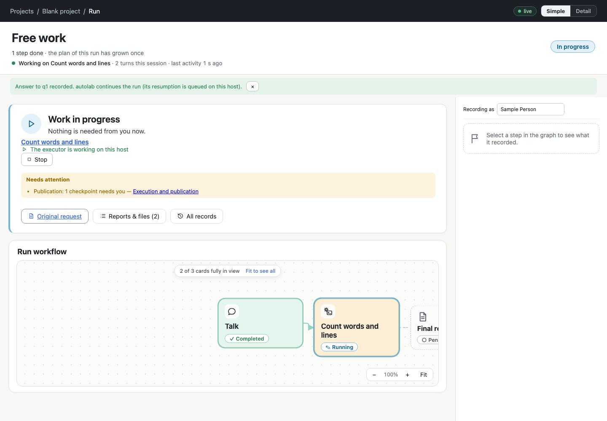

# p8/ex2 step 5 — freework placed, supplemented and started

Step 5 of [plan.md](plan.md). It is implemented and committed in agdevworld `5ba5fef`. It is not deployed (the
installed release is still `6bdcd3b`), and nothing has been added to the production projects yet: that is step 7.

## The definition

```yaml
id: freework
name: Free work
intent: |
  Serve the person's request starting from their braindump and one conversation.
  Agree in that conversation what to do, add that work to the run, do it,
  and talk again whenever the person needs to be consulted, until the request is served.
documentation: {policy: custom, plan: false, reports: false, final: true}
repositories: …   # resolved per project, below
execution: …      # resolved per project, below
nodes:
  talk:
    type: talk
    name: Talk
    description: Understand the request, hold the consultation it needs, and make the next work concrete.
```

- The braindump is the run's ordinary input.
- How the graph is updated is not in the talk's description. It is in the common guide (report 4) and in
  `docs/adjustments.md`.
- Nothing branches on the id `freework`. The template **Free work** makes the same definition under another
  id, and the step 4 tests ran the same structure as `adhoc`, `freework` and `conversation-first`.

## One mechanism for new and existing projects (`server/basics.ts`)

- **Settings are resolved when the workflow is placed:**
  - **Bindings** are the union of the project's valid workflows' bindings. Each path gets the most permissive
    access one of them already grants, so nothing becomes editable that no workflow made editable.
  - **Execution:** the agent and profile all valid workflows agree on, and the guides all of them list.
  - **A project without valid workflows** gets its root editable and every submodule and local area readonly.
  - **No intake.**
  - The resolution is printed, so the person sees what was learned from where.
- **New projects:**
  - `createProject` places freework before the initial commit (directory mode), or in the devdocs source
    (submodule mode, local and Gitea).
  - A devdocs source the person supplies is left alone, and the step says to use `wfe workflow basics`.
- **Existing projects:** `wfe workflow basics [--dry-run] [--commit [--push]] [--workspace <id> | --all]`
  reports one of:
  - `added`;
  - `would-add` (dry run, with the resolution);
  - `present`: a workflow with the id exists, edited or not, and is left alone;
  - `conflict`: a file with the name holds another workflow or cannot be read. It is reported with the reason
    and exits 1;
  - `unplaceable`: no `devdocs/workflows`, or the workspace is unavailable or protected;
  - `covered`: another workspace of the same project, or of a shared devdocs repository, already placed it.
- **Commit and push.**
  - `--commit` commits only the added file. In submodule mode it also commits the root's gitlink. The
    person's other uncommitted files stay uncommitted.
  - `--push` pushes when the branch has an upstream, and otherwise says so.
- **Reads never write.** Reading a project (summaries, repositories, the project view) never creates the file.

### What `--all --dry-run` resolves for the production projects (read only, with the new code)

| Project | Learned from | Bindings | Execution |
| --- | --- | --- | --- |
| `rts-vs-bot` | improve-game (build-game is v1: validation errors) | `game .` editable; `rts study/study-rts` readonly | the host's agent; guide `agent/review.md` |
| `ppt` | create, study | `project .` readonly; `study` editable; `wedo` editable | `ppt-agent`, profile `sonnet`, guide `agent/guide.md` |
| `agsfx` | create, improve-tools, research | `project .` readonly; `lab`, `study`, `wedo` editable | `sfx-agent`, guide `agent/guide.md` |

For the Developer: in `rts-vs-bot` the only guide every valid workflow lists is `agent/review.md`, which is
`improve-game`'s guidance for review presentations. It would be given to freework runs too. The rule is applied
as planned and not special-cased. Editing `freework.yaml` after placement is the way to change it.

## Starting it

- freework appears in the project's workflow list and in the request form like any workflow. A run of it is
  requested with the person's words.
- Starting a run copies no definition into `devdocs/workflows`. The grown definition lives in the run's
  revisions.
- **Fixed on the way.** When the person answers in the run view, the service queues the executor's resumption
  (since p6). The view still said "recording does not notify it", and that "does not wake it". The confirmation
  now comes from the service's reply: "autolab continues the run (its resumption is queued on this host)". The
  lead and the form's note say so when this host executes the run (it has jobs for it), and keep the old
  wording otherwise.



## Verification

| Check | Result |
| --- | --- |
| `npm run check` | tsc clean; **250/250** tests |
| `test/basics.test.ts` (new, 7) | new project (directory): freework valid, compiled to talk + final report, committed with the project, a run of it created; new project (submodule): in the devdocs repository's history; existing project: reads write nothing, dry run writes nothing and lists what it learned, added with the union/most-permissive bindings and the agreed execution, a second run is `present` and byte for byte unchanged, a person's edit kept; disagreeing agents → host default, no common guide → none; conflicts (another id, unreadable), the id in another file (`present`), no workflow directory (`unplaceable`); two workspaces of one project → `added` + `covered`, only the file committed (the person's file untouched), pushed to the upstream, again → `present` + `covered`, no upstream → committed, not pushed, said why; the Free work template under another id |
| Fixture tests updated | `gitea.test.ts` (the creation step list), `setup.test.ts` (a resumed creation keeps the freework that came with its devdocs source), `notify.test.ts` (the notify thread provisions a channel per workflow, so a new project also gets `wf-<project>.freework`) |
| `checks/freework.ts` freework section | 16/16: the supplement adds it to a project without it; the list and the request form offer it; a request from Simple; no definition copied; a fresh run is "0 of 1 steps done" with the talk and the final report; the talk's question is the person's task in Simple ("Your answer lets it continue"); the answer from Simple, confirmed as continuing the run; the agreed work added at the boundary; the progress "1 step done · the plan of this run has grown once"; the activity line on the added work; the graph shows it |
| `checks/simplerUi.ts`, `displayMode.ts`, `runInteraction.ts`, `docsteps.ts`, `conversation.ts` | all passed (their fixture projects now start with freework too) |

## Consequence for step 7

Placing freework in a project with Zulip delivery makes the notify thread provision `wf-<project>.freework`.
That would happen for `rts-vs-bot`, `ppt` and `agsfx`. These are the editor's existing per-workflow channels;
intake stays off for them.
