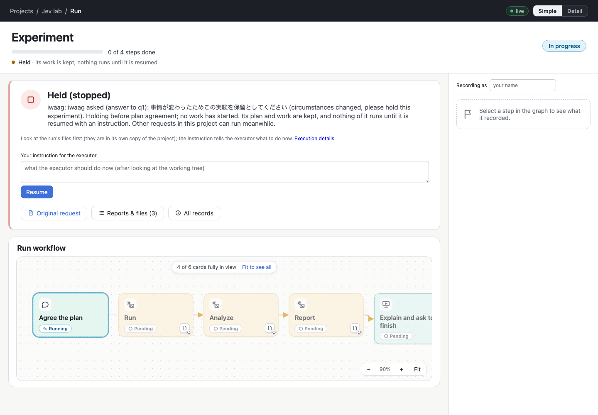
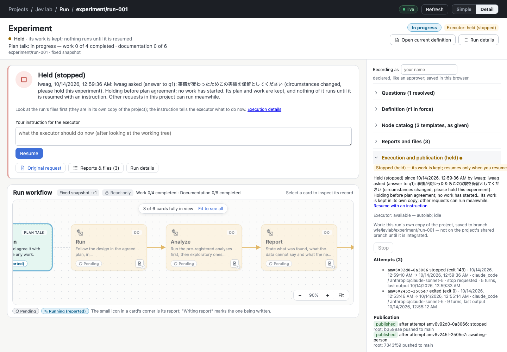

# p9 step 7 — Verification, deployment and migration

Step 7 of [plan.md](plan.md). Deployed and verified on agstudio:

- agdevworld `513aa3f` (workflow editor service and `bin/wfe`);
- agautolab `fa26c16` (`wfexec`, wfrun guide).

The superproject pointer is `e51f509`.

## Verification before deployment

| Check | Result |
| --- | --- |
| `npm run check` (agdevworld `workflow_editor`) | tsc clean, **285/285** tests, vite build ok. The release builds ran it again, in the release directories. |
| Browser and rehearsal checks | **Passed:** `exec` (26), `runInteraction` (28), `freework` (24), `simplerUi` (36), `displayMode` (34), `docsteps` (34), `review` (22), `growth`, `conversation`, `runs`, `nodes`, `appearance`, `agdev`, `backend`. **Not relevant:** `states` only renders its gallery and has no assertions. |
| Pre-existing check failures | `e2e`, `ui`, `step2`, `step3` and `step4` need a Vite dev server on :5175. `rehearsal` stops with an undefined path argument. `setup` has a strict-mode locator ("Register" resolves to 2 elements), and has been stale since p4. All seven fail the same way on the pre-p9 source `783cfcb`, run in a scratch worktree. None of them is a p9 regression. |
| agautolab, full suite on the p9 branch against the p9 editor source | **363 passed, 1 skipped, 3 failed.** The skipped test is the pre-p5/ex1 legacy transport test, which cannot see run copies; its migration was done on 2026-10-11. The failures: <ul><li>`test_wfconversation::…outage_and_a_lost_answer` fails the same way on `main` against `783cfcb` (`FakeZulip` has no `channels`).</li><li>Two `test_trial` cases fail only in the worktree, which lacks the ignored `.local/agents.local.toml` ("executable for 'claude_code' is unavailable"). They pass on agautolab `main`, and p9 does not touch that code.</li></ul> |

**Found and fixed during verification** (agdevworld `2153cf0`):

- `wfe run revisions --show r1` read the original definition from the
  project workspace and printed the file name again: the p8/ex2 bug,
  returned. It now reads from the run's copy.
- `checks/growth.ts` now names its person (`--by`). Outside an attempt, a
  host-performed run needs a named recorder; this is the intended step 3
  rule.
- `test/present.test.ts` gained a case: a run in its own copy presents its
  copy, not the project tree.

## Deployment

The order followed the plan:

1. **Read the state.**
   - `nctl status` was ok, and `nctl drift --host agstudio` was converged.
     The editor and the executor are launchd jobs, not Nautobot placements.
   - The installed release was `783cfcb`. There was no open attempt, no
     queued job and no unpublished checkpoint; the executor was idle.
   - The only non-terminal run was jevlab `experiment/run-001`, held.
2. **Quiesce.** `launchctl bootout gui/<uid>/com.agdev.agautolab-wfexec`
   paused claims, intake and Zulip delivery. Its last act had been the
   held notice for jevlab.
3. **Recovery copies** went to
   `.local/agdev/.local/backups/p9-predeploy-20261014-030156/`:
   - exec v1, notify v3, intake and present, through `sqlite3 .backup`, all
     passing `integrity_check`;
   - `registry.json`, `zulip.json`, `present.json`, `node-catalog.json`,
     `system.json`.
4. **Activate the editor.** `wfe-release.sh deploy` built `2153cf0` (with
   `npm ci` and `npm run check`), switched to it, restarted the service and
   checked its health. exec.sqlite was migrated to v2 by the new release.
5. **Migration inventory** (`bin/wfe runs migrate --dry-run`):
   - 12 terminal runs are kept;
   - jevlab `experiment/run-001` is to be migrated ("in-progress, held
     (stopped)");
   - the unattributed files are `.DS_Store` files in rts-vs-bot and ppt.
6. **Migration** (`bin/wfe runs migrate --by "Omni Agent (p9 migration)"`):
   - Recovery copies:
     `.local/agdev/.local/backups/p9-migrate-2026-10-13T18-03-38-480Z/`.
   - Migrated: `jevlab/experiment/run-001`. Its copy is `ready` on
     `wfe/jevlab/experiment/run-001`, and seq 11 is `run.relocate`.
   - Unchanged: the hold (`stopped`, reason, `by iwaag`), the answer, q1
     taken up and `plan.md`.
   - The jevlab workspace is untouched: clean on `b3599ae`.
   - Running the migration again reported "Already migrated:
     jevlab/experiment/run-001".
   - The notify outbox gained nothing; all 154 rows are `sent`.
7. **Activate the executor.** agautolab `main` was fast-forwarded to `p9`
   (`fa26c16`) and pushed. `launchctl bootstrap` restarted the executor, which
   reported idle with nothing queued.
8. **Two follow-up releases** came out of the deployment checks below:
   - `7c5355c`: the flags and the newer-commit brief;
   - `513aa3f`: the doubled period in Detail's held line, and the README
     module list.

   Each was a release switch with no open attempt and no schema change.
   `bin/wfe version` and `GET /wfe/api/version` both report `513aa3f`.

## Checks after deployment

- **jevlab request admission, checked without touching the experiment.**
  `bin/wfe request no-such-workflow … --workspace jevlab` now answers
  "no workflow "no-such-workflow" …". Before p9 the hold refused that
  request (409) before the workflow was looked up. Nothing was created:
  `wfe runs index` lists only `experiment/run-001`. The held run itself was
  not started.
- **The full A/B/resume flow with disposable runs and a real agent.** This
  ran on the deployed release in a private area (scratchpad; registry,
  `bin/wfe` and `wfexec.toml` of its own, no Zulip). The agent ran on the
  sonnet profile, through `agautolab.wfexec --settings … --once`.
  1. **A** (`experiment`, default policy) wrote `plan.md` and asked q1. It
     was saved on `wfe/trial/experiment/run-001`, and the project tree has
     no run folder. Cost $0.31.
  2. **The person answered** with the incident's words: 「ちょっと事情が変わりました、この実験を保留としてください。」
     The resumed agent took the answer up and recorded **`run.stop` as
     `trial-agent`, with its attempt id and `because: answer q1`**. The hold
     is `by trial-agent`, on Trial Person's answer 0. The checkpoint was
     published. This is the attribution the incident lacked.
  3. **B** (`quick`) was requested in the same project while A was held. It
     was claimed and done, and `notes/quick.md` is on its own branch. Cost
     $0.18. B was then accepted, and the executor's reconcile reported
     "integration 1 (quick/run-001): integrated": `main` of the trial
     remote has `notes/quick.md`.
  4. **A resumed** on the person's instruction, in its own copy. It found
     `plan.md` unchanged and asked for agreement again (q2), since the hold
     answer was not an agreement. Its brief names B's integration ("the
     project gained 2 commits on main (… log f3e9c0e8f90e..origin/main);
     none of them is in this copy"). Cost $0.15.

  The trial cost about $0.65 in all. The hold session was ended by SIGTERM,
  so it reported no cost.
- **Browser** (`http://agstudio.local:8093/wfe/` answers 200). The migrated
  run in Simple and in Detail:
  - "Held (stopped) … Its plan and work are kept, and nothing of it runs
    until it is resumed with an instruction. Other requests in this project
    can run meanwhile."
  - The activity line reads "Held · its work is kept".
  - Detail says the work is saved to `wfe/jevlab/experiment/run-001`, not on
    the shared branch until it is integrated.

  
  

### Found in these checks and fixed

| Release | Finding |
| --- | --- |
| `7c5355c` | `wfe run integrate --status`, `wfe runs index --rebuild` and `wfe runs migrate --allow-live-executor` were not registered as boolean flags, so the parser asked for a value. Tests now call the CLI forms. |
| `7c5355c` | The resume brief counted newer commits only on the workspace's local branch. Other runs' integrations reach the remote only. It now fetches the target (best effort) and counts the further-ahead of the local branch and its remote. Tested. |
| `513aa3f` | Detail's held line ended its reason with a doubled period. |

## Notes written

- **agdevworld `workflow_editor/`:** `README.md`, plus `docs/storage.md`
  (new), `docs/integration.md` (new) and `docs/runs.md`.
- **agautolab:** `agent/guides/wfrun/guide.md`.
- **Ignored `pj-agdev/.local/devenv.md`:** "workflow_editor p9 on this host".
  It covers releases, run copies, schemas, recovery copies, the migration,
  the probe and the trial.
